Forecasting Spanish Cement Consumption with SARIMA Models
================
Maria Sans Bosch & David González

- [1. Data](#1-data)
- [2. Making the series stationary](#2-making-the-series-stationary)
  - [Variance stabilisation](#variance-stabilisation)
  - [Seasonality and trend](#seasonality-and-trend)
- [3. Identification and estimation (Model
  A)](#3-identification-and-estimation-model-a)
  - [Validation of Model A](#validation-of-model-a)
- [4. Calendar effects and crisis intervention (Model
  B)](#4-calendar-effects-and-crisis-intervention-model-b)
- [5. Outlier detection (Model C)](#5-outlier-detection-model-c)
- [6. A closer look at the seasonal MA (Model
  D)](#6-a-closer-look-at-the-seasonal-ma-model-d)
- [7. Out-of-sample evaluation](#7-out-of-sample-evaluation)
- [8. Forecast for 2018](#8-forecast-for-2018)
- [9. Conclusions](#9-conclusions)

This notebook models the monthly apparent consumption of cement in Spain
(1990–2017, thousand tonnes) following the **Box–Jenkins methodology**,
and then extends the baseline SARIMA model with **calendar effects**, an
**intervention analysis** of the 2008 financial crisis, **automatic
outlier detection**, and a **deterministic-seasonality** refinement.
Models are compared with a **rolling-origin out-of-sample evaluation**.

# 1. Data

``` r
raw <- ts(scan("data/cemento.dat", quiet = TRUE), start = c(1988, 1), frequency = 12)
cement <- window(raw, start = c(1990, 1))
c(start = start(cement), end = end(cement), n = length(cement))
```

    ## start1 start2   end1   end2      n 
    ##   1990      1   2017     12    336

``` r
plot(cement, main = "Apparent cement consumption in Spain",
     ylab = "Thousand tonnes", xlab = "")
abline(v = 1990:2018, col = "grey80", lty = 3)
rect(2008, -1e4, 2010, 1e4, col = adjustcolor("red", 0.08), border = NA)
text(2009, max(cement), "2008 crisis", col = "red3", cex = 0.8)
```

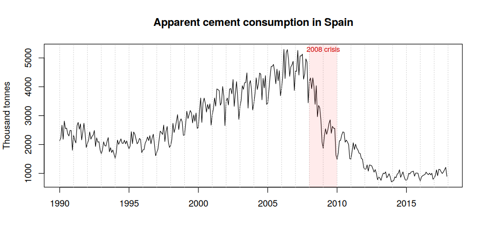

Three features stand out: strong **annual seasonality** (August and
December dips), a **growing trend** up to 2007, and a **structural
collapse** after 2008 when the Spanish construction sector crashed —
consumption fell by ~80 %.

# 2. Making the series stationary

## Variance stabilisation

``` r
par(mfrow = c(1, 2))
boxplot(cement ~ floor(time(cement)), main = "Original", xlab = "", las = 2, cex.axis = 0.6)
log_cement <- log(cement)
boxplot(log_cement ~ floor(time(log_cement)), main = "Log", xlab = "", las = 2, cex.axis = 0.6)
```

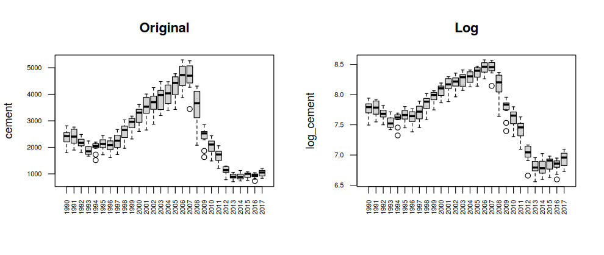

The spread of each yearly box grows with the level, so the variance is
not constant. After a log transform the box heights are much more
homogeneous, so we work with $\log(X_t)$.

## Seasonality and trend

``` r
par(mfrow = c(1, 2))
monthplot(log_cement, main = "Monthplot: log series", ylab = "")
monthplot(diff(log_cement, 12), main = "Monthplot: after (1 - B^12)", ylab = "")
```

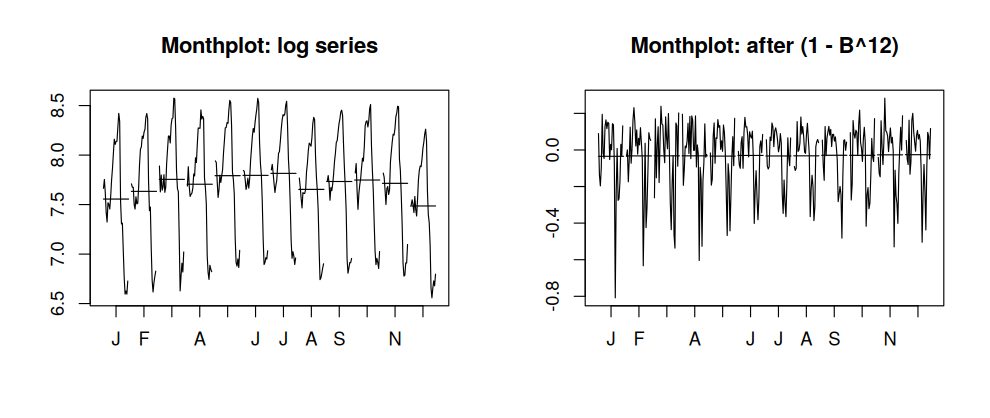

The monthly means differ clearly (seasonal pattern), and they align
after a seasonal difference. To decide on regular differencing we
compare variances — over-differencing shows up as an *increase* in
variance:

``` r
candidates <- list(
  "log X"                    = log_cement,
  "(1-B^12) log X"           = diff(log_cement, 12),
  "(1-B)(1-B^12) log X"      = diff(diff(log_cement, 12)),
  "(1-B)^2 (1-B^12) log X"   = diff(diff(diff(log_cement, 12)))
)
fmt(data.frame(transformation = names(candidates),
               variance = sapply(candidates, var)), 5)
```

| transformation         | variance |
|:-----------------------|---------:|
| log X                  |  0.27864 |
| (1-B^12) log X         |  0.03054 |
| (1-B)(1-B^12) log X    |  0.01194 |
| (1-B)^2 (1-B^12) log X |  0.03479 |

The second regular difference increases the variance, so the stationary
series is

$$W_t = (1-B)(1-B^{12}) \log X_t$$

``` r
W <- diff(diff(log_cement, 12))
plot(W, main = expression(W[t] == (1-B)(1-B^12) * log(X[t])), ylab = "", xlab = "")
abline(h = 0, col = 2)
```

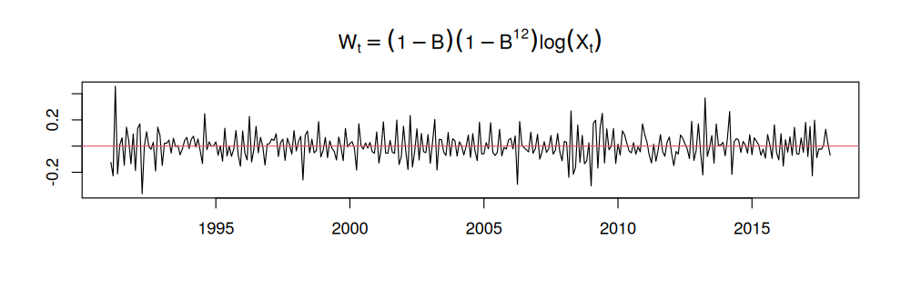

# 3. Identification and estimation (Model A)

``` r
par(mfrow = c(1, 2))
acf(W,  ylim = c(-1, 1), lag.max = 72, lwd = 2, col = c(2, rep(1, 11)), main = "ACF of W")
pacf(W, ylim = c(-1, 1), lag.max = 72, lwd = 2, col = c(rep(1, 11), 2), main = "PACF of W")
```

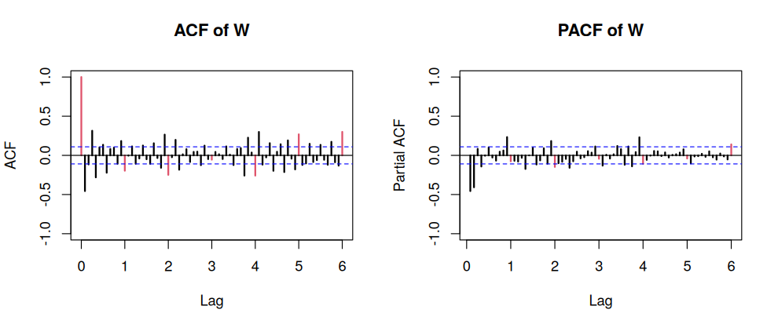

- **Regular part** (lags close to the origin): ACF cuts off after lag 1
  → MA(1); PACF has two significant lags → AR(2).
- **Seasonal part** (red lags 12, 24, …): ACF has two significant
  seasonal lags → seasonal MA(2); PACF decays.

We estimate the proposed candidates plus a few neighbours and compare
information criteria and coefficient significance:

``` r
# do.call() embeds the data in the model call, so predict() can later
# find the regressors even when the model was fitted inside a function
fit_sarima <- function(order, seasonal, y = log_cement, xreg = NULL) {
  do.call("arima", list(x = y, order = order,
                      seasonal = list(order = seasonal, period = 12), xreg = xreg))
}
grid <- list(
  list(c(2,1,0), c(0,1,2)), list(c(0,1,1), c(0,1,2)), list(c(2,1,1), c(0,1,2)),
  list(c(2,1,1), c(1,1,1)), list(c(1,1,1), c(0,1,2)), list(c(0,1,1), c(0,1,1))
)
selection <- do.call(rbind, lapply(grid, function(g) {
  m <- fit_sarima(g[[1]], g[[2]])
  data.frame(model = sprintf("ARIMA(%s)(%s)12", paste(g[[1]], collapse = ","),
                             paste(g[[2]], collapse = ",")),
             AIC = m$aic, BIC = BIC(m),
             min_abs_t = min(abs(t_ratios(m))),
             all_significant = all(abs(t_ratios(m)) > 2))
}))
fmt(selection[order(selection$AIC), ], 2)
```

| model                 |     AIC |     BIC | min_abs_t | all_significant |
|:----------------------|--------:|--------:|----------:|:----------------|
| ARIMA(2,1,1)(0,1,2)12 | -766.45 | -743.78 |      3.86 | TRUE            |
| ARIMA(2,1,0)(0,1,2)12 | -759.14 | -740.25 |      6.22 | TRUE            |
| ARIMA(2,1,1)(1,1,1)12 | -758.80 | -736.13 |      4.00 | TRUE            |
| ARIMA(1,1,1)(0,1,2)12 | -736.73 | -717.84 |      1.60 | FALSE           |
| ARIMA(0,1,1)(0,1,2)12 | -736.29 | -721.18 |      6.53 | TRUE            |
| ARIMA(0,1,1)(0,1,1)12 | -700.07 | -688.73 |     11.51 | TRUE            |

**Model A: ARIMA(2,1,1)(0,1,2)₁₂** has the lowest AIC and BIC with all
coefficients significant.

``` r
model_A <- fit_sarima(c(2, 1, 1), c(0, 1, 2))
coef_table(model_A)
```

| term | estimate |  s.e. |      t |
|:-----|---------:|------:|-------:|
| ar1  |   -0.944 | 0.093 | -10.15 |
| ar2  |   -0.538 | 0.053 | -10.22 |
| ma1  |    0.405 | 0.105 |   3.86 |
| sma1 |   -0.635 | 0.075 |  -8.43 |
| sma2 |   -0.365 | 0.063 |  -5.78 |

``` r
c(sigma2 = model_A$sigma2, loglik = model_A$loglik, AIC = model_A$aic)
```

    ##        sigma2        loglik           AIC 
    ##  4.717096e-03  3.892226e+02 -7.664452e+02

``` r
check_roots(model_A)
```

    ## Min |AR root| = 1.3636  -> stationary
    ## Min |MA root| = 1.0000  -> NOT invertible (root on the unit circle)

## Validation of Model A

``` r
plot_residual_diagnostics(model_A)
```

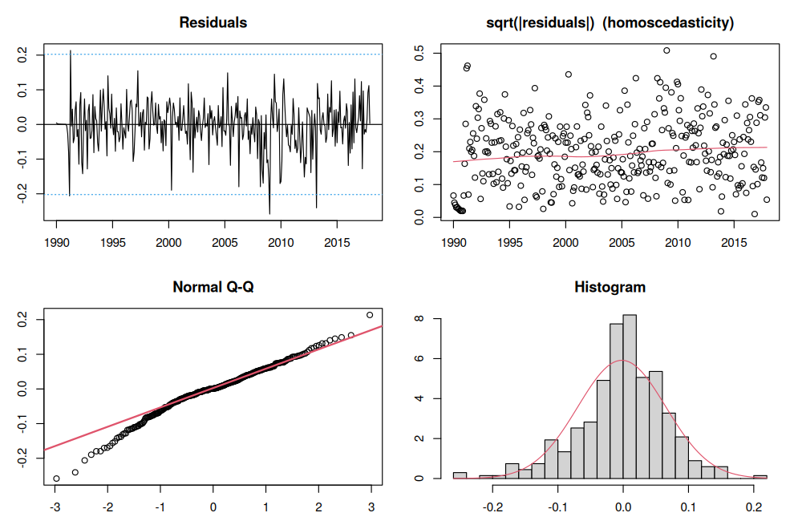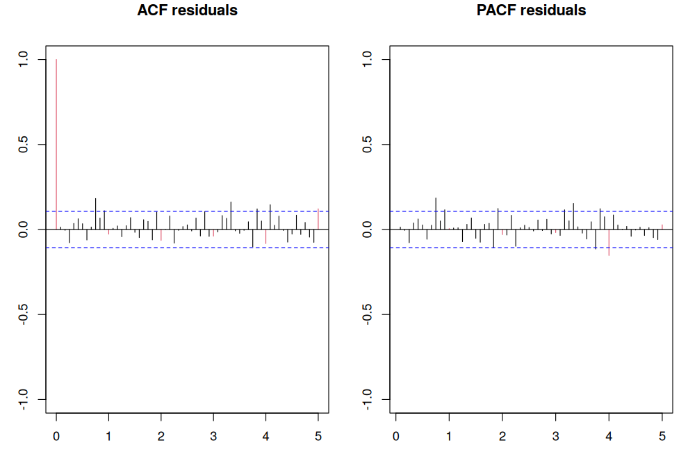

``` r
fmt(residual_tests(model_A, log_cement))
```

| check            | test               | p_value | passes_5pct |
|:-----------------|:-------------------|--------:|:------------|
| Normality        | Shapiro-Wilk       |   0.000 | no          |
| Normality        | Anderson-Darling   |   0.000 | no          |
| Normality        | Jarque-Bera        |   0.000 | no          |
| Homoscedasticity | Breusch-Pagan      |   0.416 | yes         |
| Independence     | Durbin-Watson      |   0.390 | yes         |
| Independence     | Ljung-Box (lag 12) |   0.002 | no          |
| Independence     | Ljung-Box (lag 24) |   0.012 | no          |
| Independence     | Ljung-Box (lag 48) |   0.001 | no          |

Model A fails validation: the residuals have a heavy left tail (large
negative shocks, e.g. 2009 and 2013), normality is rejected by all three
tests, and the Ljung–Box tests detect remaining autocorrelation. Note
also that the MA polynomial has a root on the unit circle — we come back
to this in Section 6. The model cannot explain the crisis or
calendar-driven fluctuations, which motivates the extensions below.

# 4. Calendar effects and crisis intervention (Model B)

Monthly construction activity depends on how many **working days** a
month has, and on whether **Easter** falls in March or April. We build
both regressors (see `R/calendar_effects.R`), together with step dummies
for the phases of the crisis:

``` r
make_regressors <- function(start, n) {
  yr <- (start[1] * 12 + start[2] - 1 + 0:(n - 1)) %/% 12
  cbind(
    easter       = as.numeric(easter_effect(start, n)),
    trading_days = as.numeric(trading_days(start, n)),
    crisis_08_09 = as.integer(yr %in% 2008:2009),
    crisis_10_11 = as.integer(yr %in% 2010:2011),
    post_2012    = as.integer(yr >= 2012)
  )
}
X <- make_regressors(start(log_cement), length(log_cement))
head(X)
```

    ##      easter trading_days crisis_08_09 crisis_10_11 post_2012
    ## [1,]    0.0          3.0            0            0         0
    ## [2,]    0.0          0.0            0            0         0
    ## [3,]   -0.5         -0.5            0            0         0
    ## [4,]    0.5         -1.5            0            0         0
    ## [5,]    0.0          3.0            0            0         0
    ## [6,]    0.0         -1.5            0            0         0

Note that because the model is differenced, a step dummy acts as a
**level shift** for the duration of each phase.

``` r
pre_B <- fit_sarima(c(2, 1, 1), c(0, 1, 2), xreg = X)
coef_table(pre_B)
```

| term         | estimate |  s.e. |      t |
|:-------------|---------:|------:|-------:|
| ar1          |   -0.046 | 0.477 |  -0.10 |
| ar2          |   -0.069 | 0.112 |  -0.62 |
| ma1          |   -0.163 | 0.477 |  -0.34 |
| sma1         |   -0.683 | 0.086 |  -7.90 |
| sma2         |   -0.317 | 0.055 |  -5.74 |
| easter       |   -0.108 | 0.009 | -11.88 |
| trading_days |    0.011 | 0.001 |  15.30 |
| crisis_08_09 |    0.074 | 0.047 |   1.57 |
| crisis_10_11 |    0.004 | 0.066 |   0.07 |
| post_2012    |   -0.115 | 0.079 |  -1.45 |

Both calendar regressors are extremely significant, while the AR/MA
coefficients of Model A lose significance: part of the structure that
the ARMA terms were absorbing was actually calendar-driven. We
re-identify the ARMA structure on the series *without* the regression
effects:

``` r
linear_B <- ts(log_cement - X %*% coef(pre_B)[colnames(X)],
               start = start(log_cement), frequency = 12)
W_B <- diff(diff(linear_B, 12))
par(mfrow = c(1, 2))
acf(W_B,  ylim = c(-1, 1), lag.max = 72, lwd = 2, col = c(2, rep(1, 11)), main = "ACF")
pacf(W_B, ylim = c(-1, 1), lag.max = 72, lwd = 2, col = c(rep(1, 11), 2), main = "PACF")
```

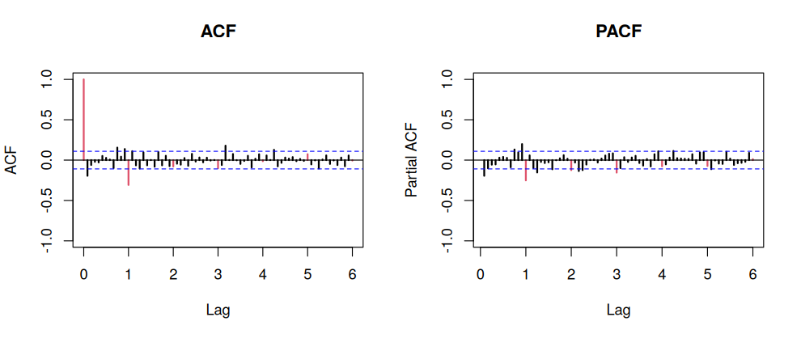

The regular part now looks like an MA(1). The seasonal part keeps the
same structure.

``` r
model_B <- fit_sarima(c(0, 1, 1), c(0, 1, 2), xreg = X)
coef_table(model_B)
```

| term         | estimate |  s.e. |      t |
|:-------------|---------:|------:|-------:|
| ma1          |   -0.224 | 0.059 |  -3.79 |
| sma1         |   -0.682 | 0.085 |  -8.01 |
| sma2         |   -0.318 | 0.055 |  -5.81 |
| easter       |   -0.110 | 0.009 | -12.07 |
| trading_days |    0.011 | 0.001 |  15.28 |
| crisis_08_09 |    0.077 | 0.047 |   1.63 |
| crisis_10_11 |   -0.003 | 0.065 |  -0.04 |
| post_2012    |   -0.122 | 0.079 |  -1.56 |

``` r
check_roots(model_B)
```

    ## Min |AR root| = NA  -> no roots
    ## Min |MA root| = 1.0000  -> NOT invertible (root on the unit circle)

Individually the crisis dummies are borderline, so we test them
**jointly** with a likelihood-ratio test:

``` r
model_B_calendar_only <- fit_sarima(c(0, 1, 1), c(0, 1, 2), xreg = X[, 1:2])
LR <- 2 * (model_B$loglik - model_B_calendar_only$loglik)
c(LR = LR, df = 3, p_value = pchisq(LR, df = 3, lower.tail = FALSE))
```

    ##           LR           df      p_value 
    ## 12.035210109  3.000000000  0.007263514

The crisis phases are jointly significant at 5 %, so they are kept.

**Interpretation** (coefficients are on the log scale):

- Each extra working day in a month increases consumption by about 1.1
  %; swapping a weekend day for a weekday (+3.5 in the regressor) adds
  about 4.1 %.
- When the whole Easter period falls in March instead of April, March
  consumption is about 10.4 % lower (and April’s correspondingly
  higher).

With the calendar effects, residual autocorrelation disappears (all
Ljung–Box tests pass), but normality is still rejected.

``` r
fmt(residual_tests(model_B, log_cement))
```

| check            | test               | p_value | passes_5pct |
|:-----------------|:-------------------|--------:|:------------|
| Normality        | Shapiro-Wilk       |   0.000 | no          |
| Normality        | Anderson-Darling   |   0.085 | yes         |
| Normality        | Jarque-Bera        |   0.000 | no          |
| Homoscedasticity | Breusch-Pagan      |   0.599 | yes         |
| Independence     | Durbin-Watson      |   0.329 | yes         |
| Independence     | Ljung-Box (lag 12) |   0.070 | yes         |
| Independence     | Ljung-Box (lag 24) |   0.111 | yes         |
| Independence     | Ljung-Box (lag 48) |   0.080 | yes         |

# 5. Outlier detection (Model C)

We run an iterative search for additive outliers (AO), level shifts (LS)
and transitory changes (TC) on the residuals of Model B (critical value
2.9):

``` r
out <- outdetec(model_B, dif = c(1, 12), crit = 2.9, LS = TRUE)
outliers <- out$atip[order(out$atip$Obs), ]
outliers$date <- format(as.Date(sprintf("%d-%02d-01",
  start(log_cement)[1] + (outliers$Obs - 1) %/% 12, (outliers$Obs - 1) %% 12 + 1)), "%b %Y")
outliers$effect_pct <- 100 * (exp(outliers$W_coeff) - 1)
fmt(outliers[, c("date", "type_detected", "W_coeff", "effect_pct", "ABS_L_Ratio")], 2)
```

| date     | type_detected | W_coeff | effect_pct | ABS_L_Ratio |
|:---------|:--------------|--------:|-----------:|------------:|
| Mar 1991 | AO            |   -0.10 |      -9.81 |        3.22 |
| Jan 1992 | AO            |   -0.10 |      -9.24 |        3.12 |
| Jul 1993 | AO            |    0.09 |       9.46 |        2.98 |
| Mar 1997 | TC            |    0.11 |      11.98 |        3.09 |
| Jan 2002 | TC            |    0.13 |      14.30 |        3.44 |
| Jun 2008 | AO            |   -0.14 |     -12.63 |        4.01 |
| Dec 2008 | LS            |   -0.18 |     -16.16 |        4.11 |
| Jan 2009 | AO            |   -0.11 |     -10.85 |        3.47 |
| Dec 2009 | TC            |   -0.18 |     -16.37 |        4.23 |
| Mar 2013 | TC            |   -0.12 |     -11.38 |        3.21 |

Four of the ten detected outliers fall in the **2008–2009 crisis**,
including a permanent **level shift of about −16 % in December 2008**.

``` r
log_cement_lin <- log_cement
log_cement_lin[] <- lineal(as.numeric(log_cement), out$atip)
wLS <- sum(out$atip$W_coeff[out$atip$type_detected == "LS"])

par(mfrow = c(1, 2))
plot(cement, main = "Observed (black) vs outlier-free (red)", ylab = "", xlab = "")
lines(exp(log_cement_lin), col = 2)
plot(exp(log_cement - log_cement_lin), main = "Multiplicative outlier effect",
     ylab = "", xlab = "")
abline(h = 1, lty = 3)
```

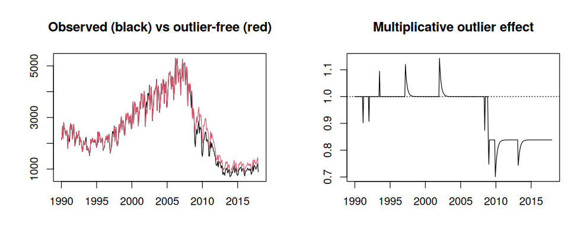

``` r
W_C <- diff(diff(ts(log_cement_lin - X %*% coef(model_B)[colnames(X)],
                    start = start(log_cement), frequency = 12), 12))
par(mfrow = c(1, 2))
acf(W_C,  ylim = c(-1, 1), lag.max = 72, lwd = 2, col = c(2, rep(1, 11)), main = "ACF")
pacf(W_C, ylim = c(-1, 1), lag.max = 72, lwd = 2, col = c(rep(1, 11), 2), main = "PACF")
```

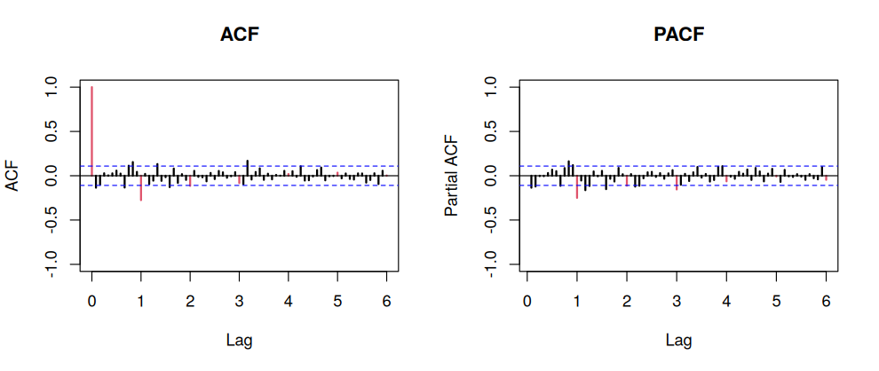

The same ARIMA(0,1,1)(0,1,2)₁₂ structure is identified and has the best
AIC among the candidates with significant coefficients:

``` r
model_C <- fit_sarima(c(0, 1, 1), c(0, 1, 2), y = log_cement_lin, xreg = X)
coef_table(model_C)
```

| term         | estimate |  s.e. |      t |
|:-------------|---------:|------:|-------:|
| ma1          |   -0.210 | 0.056 |  -3.78 |
| sma1         |   -0.658 | 0.080 |  -8.18 |
| sma2         |   -0.342 | 0.053 |  -6.40 |
| easter       |   -0.102 | 0.008 | -13.56 |
| trading_days |    0.012 | 0.001 |  18.43 |
| crisis_08_09 |    0.037 | 0.039 |   0.95 |
| crisis_10_11 |   -0.104 | 0.053 |  -1.96 |
| post_2012    |   -0.228 | 0.064 |  -3.54 |

``` r
fmt(residual_tests(model_C, log_cement_lin))
```

| check            | test               | p_value | passes_5pct |
|:-----------------|:-------------------|--------:|:------------|
| Normality        | Shapiro-Wilk       |   0.379 | yes         |
| Normality        | Anderson-Darling   |   0.549 | yes         |
| Normality        | Jarque-Bera        |   0.465 | yes         |
| Homoscedasticity | Breusch-Pagan      |   0.250 | yes         |
| Independence     | Durbin-Watson      |   0.345 | yes         |
| Independence     | Ljung-Box (lag 12) |   0.075 | yes         |
| Independence     | Ljung-Box (lag 24) |   0.027 | no          |
| Independence     | Ljung-Box (lag 48) |   0.056 | yes         |

Removing the outliers fixes normality. Only the Ljung–Box test at lag 24
is borderline.

# 6. A closer look at the seasonal MA (Model D)

In Models A, B and C the two seasonal MA coefficients add up to almost
exactly −1:

``` r
fmt(data.frame(
  model = c("A", "B", "C"),
  sma1 = sapply(list(model_A, model_B, model_C), function(m) coef(m)["sma1"]),
  sma2 = sapply(list(model_A, model_B, model_C), function(m) coef(m)["sma2"]),
  sum  = sapply(list(model_A, model_B, model_C), function(m) sum(coef(m)[c("sma1", "sma2")])),
  min_MA_root_modulus = sapply(list(model_A, model_B, model_C),
                               function(m) min(root_moduli(m)$MA))
), 4)
```

| model |    sma1 |    sma2 |     sum | min_MA_root_modulus |
|:------|--------:|--------:|--------:|--------------------:|
| A     | -0.6350 | -0.3650 | -1.0000 |                   1 |
| B     | -0.6815 | -0.3185 | -1.0000 |                   1 |
| C     | -0.6576 | -0.3423 | -0.9999 |                   1 |

With $\Theta_1 + \Theta_2 = -1$, the seasonal MA polynomial factorises
as $(1 - B^{12})(1 - \Theta_2 B^{12})$: it contains a **unit root that
cancels the seasonal difference**. The series was seasonally
*over-differenced*, which means the seasonal pattern is essentially
**deterministic** (a fixed profile of monthly means) rather than
stochastic.

The natural fix is to drop the seasonal difference and model seasonality
with 11 monthly dummies, keeping a seasonal MA(1) for the remaining
seasonal correlation:

``` r
make_month_dummies <- function(start, n) {
  m <- ((start[2] - 1 + 0:(n - 1)) %% 12) + 1
  d <- outer(m, 2:12, "==") * 1
  colnames(d) <- month.abb[2:12]
  d
}
XD <- cbind(make_month_dummies(start(log_cement), length(log_cement)), X)
model_D <- fit_sarima(c(0, 1, 1), c(0, 0, 1), y = log_cement_lin, xreg = XD)
coef_table(model_D)
```

| term         | estimate |  s.e. |      t |
|:-------------|---------:|------:|-------:|
| ma1          |   -0.209 | 0.054 |  -3.85 |
| sma1         |    0.322 | 0.049 |   6.53 |
| Feb          |    0.071 | 0.010 |   7.05 |
| Mar          |    0.177 | 0.012 |  14.31 |
| Apr          |    0.166 | 0.014 |  11.98 |
| May          |    0.233 | 0.015 |  15.86 |
| Jun          |    0.241 | 0.015 |  15.79 |
| Jul          |    0.254 | 0.015 |  16.39 |
| Aug          |    0.096 | 0.015 |   6.29 |
| Sep          |    0.177 | 0.015 |  11.95 |
| Oct          |    0.192 | 0.014 |  13.81 |
| Nov          |    0.161 | 0.013 |  12.87 |
| Dec          |   -0.055 | 0.010 |  -5.20 |
| easter       |   -0.102 | 0.007 | -13.68 |
| trading_days |    0.012 | 0.001 |  18.92 |
| crisis_08_09 |    0.037 | 0.039 |   0.95 |
| crisis_10_11 |   -0.105 | 0.053 |  -1.98 |
| post_2012    |   -0.229 | 0.064 |  -3.57 |

``` r
check_roots(model_D)
```

    ## Min |AR root| = NA  -> no roots
    ## Min |MA root| = 1.0991  -> invertible

The MA polynomial is now strictly invertible, and the deterministic
monthly profile is easy to read: relative to January, consumption is
~25–30 % higher in May–July, drops in August (holidays), and December is
the lowest month.

``` r
plot_residual_diagnostics(model_D)
```

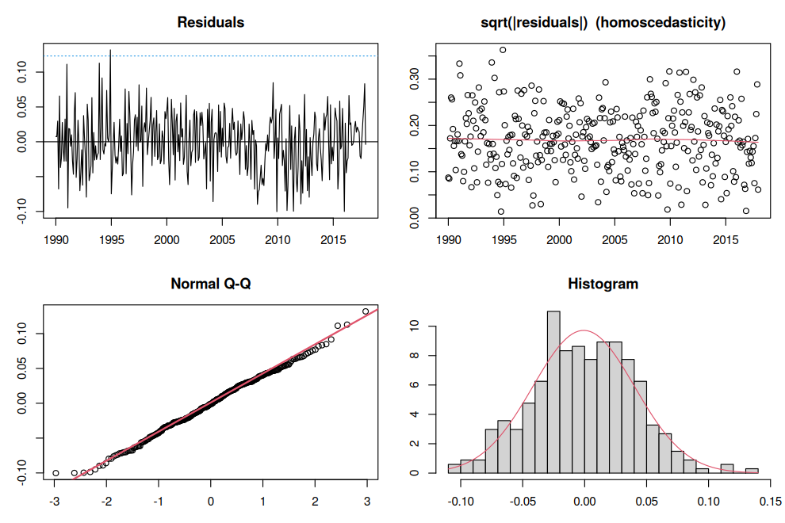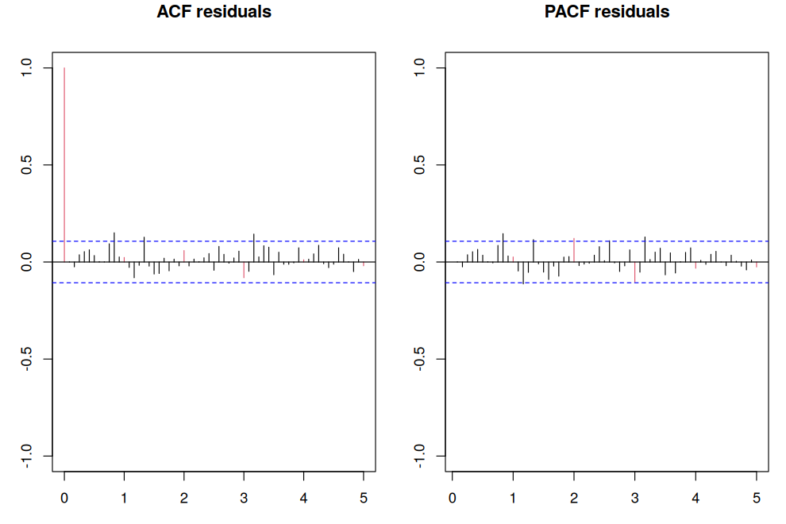

``` r
fmt(residual_tests(model_D, log_cement_lin))
```

| check            | test               | p_value | passes_5pct |
|:-----------------|:-------------------|--------:|:------------|
| Normality        | Shapiro-Wilk       |   0.502 | yes         |
| Normality        | Anderson-Darling   |   0.515 | yes         |
| Normality        | Jarque-Bera        |   0.930 | yes         |
| Homoscedasticity | Breusch-Pagan      |   0.343 | yes         |
| Independence     | Durbin-Watson      |   0.483 | yes         |
| Independence     | Ljung-Box (lag 12) |   0.140 | yes         |
| Independence     | Ljung-Box (lag 24) |   0.162 | yes         |
| Independence     | Ljung-Box (lag 48) |   0.150 | yes         |

Model D is the only model that passes **every** normality,
homoscedasticity and independence test.

Note: AIC values of Model D are not comparable with A–C because the
likelihoods are computed on differently differenced series; we compare
the models on out-of-sample accuracy instead.

# 7. Out-of-sample evaluation

Instead of a single hold-out year, we use a **rolling-origin
evaluation**: each model is re-estimated on data up to December of 2013,
2014, 2015 and 2016, and then forecasts the following 12 months (48
forecasts per model). Calendar regressors for the forecast horizon are
known in advance; crisis phases are set according to their definition.

*Limitation:* outliers are detected once on the full sample. No outlier
is detected after March 2013, so the effect on the test periods is
minimal.

``` r
specs <- list(
  A = list(y = log_cement,     order = c(2,1,1), seasonal = c(0,1,2), xreg = NULL, wLS = 0),
  B = list(y = log_cement,     order = c(0,1,1), seasonal = c(0,1,2), xreg = X,    wLS = 0),
  C = list(y = log_cement_lin, order = c(0,1,1), seasonal = c(0,1,2), xreg = X,    wLS = wLS),
  D = list(y = log_cement_lin, order = c(0,1,1), seasonal = c(0,0,1), xreg = XD,   wLS = wLS)
)

forecast_from_origin <- function(spec, origin_year, h = 12) {
  y_train <- window(spec$y, end = c(origin_year, 12))
  n_train <- length(y_train)
  xr_train <- if (is.null(spec$xreg)) NULL else spec$xreg[1:n_train, , drop = FALSE]
  xr_future <- if (is.null(spec$xreg)) NULL else spec$xreg[n_train + 1:h, , drop = FALSE]
  m <- fit_sarima(spec$order, spec$seasonal, y = y_train, xreg = xr_train)
  arima_forecast(m, h = h, newxreg = xr_future, wLS = spec$wLS)
}

origins <- 2013:2016
results <- do.call(rbind, lapply(names(specs), function(name) {
  fcs <- lapply(origins, function(o) forecast_from_origin(specs[[name]], o))
  fc_all <- do.call(rbind, fcs)
  actual <- window(cement, start = c(origins[1] + 1, 1))
  data.frame(model = name, t(forecast_metrics(fc_all, actual)))
}))
fmt(results, 3)
```

| model |   RMSE |    MAE | RMSPE |  MAPE | Coverage | CI_width |
|:------|-------:|-------:|------:|------:|---------:|---------:|
| A     | 87.883 | 68.514 | 0.086 | 0.070 |    0.979 |  417.449 |
| B     | 79.497 | 65.901 | 0.080 | 0.068 |    1.000 |  376.344 |
| C     | 77.462 | 63.751 | 0.078 | 0.066 |    0.979 |  316.780 |
| D     | 72.515 | 59.586 | 0.073 | 0.062 |    0.979 |  308.281 |

Every extension improves on the previous model in all point-forecast
metrics, while prediction intervals become **narrower without losing
coverage**: Model D reduces RMSE by 17 % and interval width by 26 %
relative to the baseline.

``` r
par(mfrow = c(2, 2), mar = c(3, 4, 3, 1))
for (name in names(specs)) {
  fc <- forecast_from_origin(specs[[name]], 2016)
  plot_forecast(cement, fc, from = 2014, main = paste("Model", name, "- forecast of 2017"))
}
```

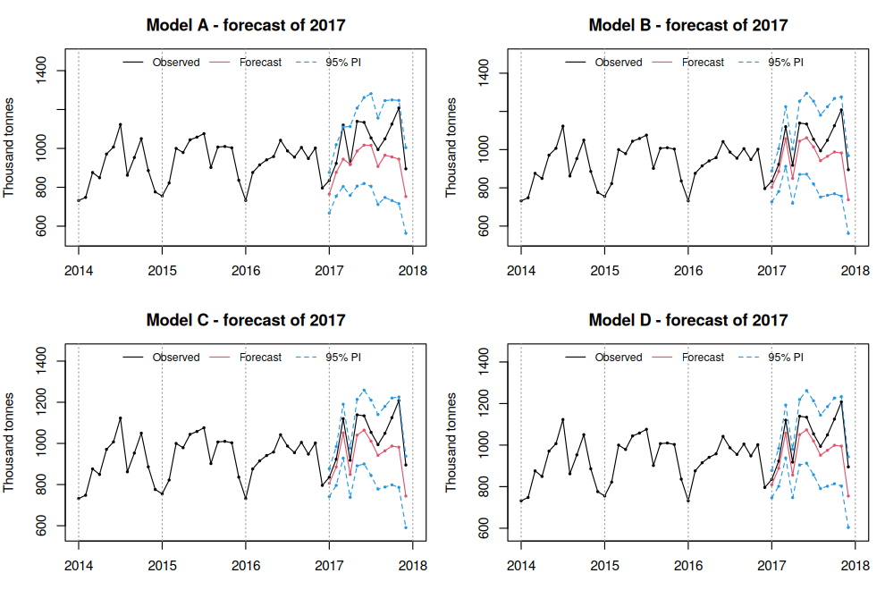

# 8. Forecast for 2018

All models under-predict 2017, a year in which consumption started to
recover; this upturn was not yet visible in the training data.

``` r
best <- results$model[which.min(results$RMSE)]
best
```

    ## [1] "D"

``` r
h <- 12
X_future  <- make_regressors(c(2018, 1), h)
XD_future <- cbind(make_month_dummies(c(2018, 1), h), X_future)
spec <- specs[[best]]
final_model <- fit_sarima(spec$order, spec$seasonal, y = spec$y, xreg = spec$xreg)
newx <- if (best == "A") NULL else if (best == "D") XD_future else X_future
fc_2018 <- arima_forecast(final_model, h = h, newxreg = newx, wLS = spec$wLS)
fc_2018$month <- month.abb
fmt(fc_2018[, c("month", "lower", "forecast", "upper")], 0)
```

| month | lower | forecast | upper |
|:------|------:|---------:|------:|
| Jan   |   954 |     1034 |  1121 |
| Feb   |   970 |     1075 |  1191 |
| Mar   |  1024 |     1156 |  1304 |
| Apr   |  1059 |     1213 |  1391 |
| May   |  1141 |     1326 |  1542 |
| Jun   |  1070 |     1259 |  1483 |
| Jul   |  1076 |     1282 |  1528 |
| Aug   |   950 |     1145 |  1379 |
| Sep   |   937 |     1142 |  1390 |
| Oct   |  1048 |     1289 |  1586 |
| Nov   |  1019 |     1265 |  1571 |
| Dec   |   754 |      945 |  1184 |

``` r
plot_forecast(cement, fc_2018, from = 2013,
              main = paste("Model", best, "- 12-month forecast with 95% prediction interval"))
```

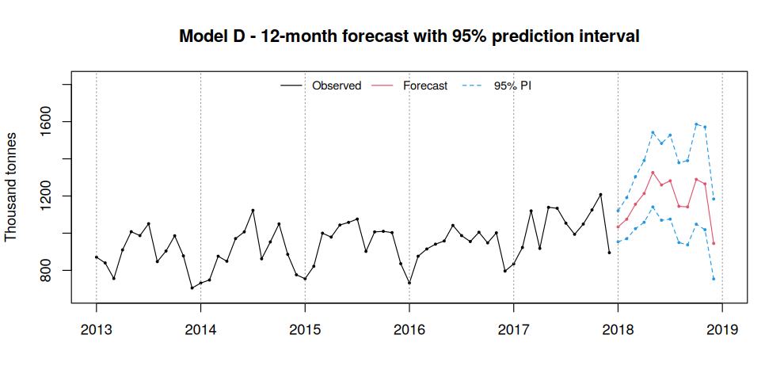

# 9. Conclusions

- **Calendar effects are the single biggest improvement.** Working days
  and Easter are highly significant and absorb structure that the plain
  SARIMA model was fitting with extra ARMA terms.
- **The 2008 crisis is visible both as an intervention and as
  outliers**: the crisis phases are jointly significant and the outlier
  search finds a permanent level shift of about −16 % in December 2008.
- **Seasonality is deterministic.** The seasonal MA unit root in the
  SARIMA models indicates seasonal over-differencing; replacing the
  seasonal difference with monthly dummies (Model D) gives an invertible
  model.
- **Each extension improves out-of-sample accuracy.** In the
  rolling-origin evaluation the final model (D) has the lowest RMSE and
  MAPE and the narrowest prediction intervals while keeping ~98 %
  coverage, and it is the only model that passes all residual
  diagnostics.
- **Possible extensions:** detecting outliers inside each rolling
  window, modelling volatility clustering (GARCH-type errors), and
  comparing with automatic approaches such as `forecast::auto.arima`,
  ETS or Prophet.

``` r
sessionInfo()$R.version$version.string
```

    ## [1] "R version 4.3.3 (2024-02-29)"
